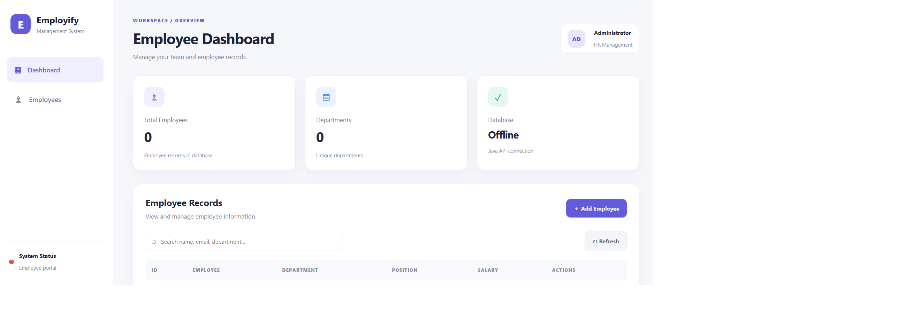

# 👥 Employify — Employee Management System

<p align="center">
  A Java-based employee management application built with Hibernate ORM, MySQL, and a responsive web interface.
</p>

<p align="center">
  
  
  
  
</p>

---

## 📌 Overview

**Employify** is a Java-based Employee Management System designed to simplify employee record management through CRUD operations (Create, Read, Update, and Delete).

Built using **Java, Maven, Hibernate ORM, and MySQL**, the application connects a web-based dashboard to a Java API for managing employee information efficiently.

The project demonstrates practical knowledge of Java backend development, object-relational mapping, database integration, REST-style API development, and frontend development.

## ✨ Features

- 👤 **Employee Management** — Add, view, update, and delete employee records.
- 🔎 **Search Functionality** — Find employees using the dashboard search.
- 📊 **Dashboard Overview** — View employee totals and department statistics.
- 🗄️ **Database Integration** — Store employee information in MySQL.
- 🔗 **Hibernate ORM** — Map Java entities to database tables.
- 🌐 **Java API** — Handle employee requests using HTTP endpoints and JSON.
- 📱 **Responsive Interface** — Access the dashboard on desktop and mobile screens.
- ⚙️ **Maven Build Management** — Manage project dependencies and builds.

## 🛠️ Tech Stack

| Technology | Purpose |
|---|---|
| Java 17 | Backend programming |
| Maven | Dependency and build management |
| Hibernate ORM 6 | Object-relational mapping |
| MySQL | Relational database |
| HTML5 | Web page structure |
| CSS3 | Styling and responsive layout |
| JavaScript | Frontend interactions |
| Jackson | JSON serialization and deserialization |
| VS Code | Development environment |

## 🏗️ Project Architecture

```text
Employify
│
├── Frontend
│   ├── HTML
│   ├── CSS
│   └── JavaScript
│
├── Java Backend
│   ├── Employee.java
│   ├── EmployeeService.java
│   ├── EmployeeApiServer.java
│   ├── HibernateUtil.java
│   └── DatabaseTest.java
│
├── Database
│   └── MySQL
│
├── pom.xml
├── .gitignore
└── README.md
```

*Note: The diagram illustrates the main components; your actual file structure may differ.*

## 🚀 Getting Started

### Prerequisites

Make sure you have installed:

- [Java JDK 17](https://adoptium.net/)
- [Apache Maven](https://maven.apache.org/download.cgi)
- [MySQL Community Server](https://dev.mysql.com/downloads/mysql/)
- [Visual Studio Code](https://code.visualstudio.com/)

### 1. Clone the Repository

```bash
git clone https://github.com/YOUR_USERNAME/YOUR_REPOSITORY.git
cd YOUR_REPOSITORY
```

Replace the repository URL with your actual GitHub repository.

### 2. Configure MySQL

Start your MySQL server and create the database:

```sql
CREATE DATABASE employee_db;
```

Configure Hibernate to use the database. Set your database connection details through environment variables or a local configuration file excluded from Git.

Example environment variables:

```text
DB_URL=jdbc:mysql://localhost:3306/employee_db
DB_USERNAME=your_mysql_username
DB_PASSWORD=your_mysql_password
```

The application must be configured to read these variables before they will take effect. Never commit real credentials to GitHub.

### 3. Build the Project

From the project root, run:

```bash
mvn clean compile
```

### 4. Start the Java API

Run the API server using your project's configured Maven execution command or the appropriate Java entry point.

For example, if your Maven Exec Plugin is configured for the API server:

```bash
mvn exec:java -Dexec.mainClass="com.example.EmployeeApiServer"
```

When the server starts successfully, the API is available locally at:

```text
http://localhost:8080/api/employees
```

### 5. Open the Frontend

Open `src/main/resources/static/index.html` in your browser using the VS Code Live Server extension.

Ensure the Java backend and MySQL server are running so the dashboard can retrieve employee records.

## 🔌 API Endpoints

| Method | Endpoint | Description |
|---|---|---|
| `GET` | `/api/employees` | Retrieve all employees |
| `POST` | `/api/employees` | Create an employee |
| `GET` | `/api/employees/{id}` | Retrieve an employee by ID |
| `PUT` | `/api/employees/{id}` | Update an employee |
| `DELETE` | `/api/employees/{id}` | Delete an employee |

These endpoints describe the application's intended API operations. The backend must be running for them to respond.

## 📋 Employee Information

The system manages employee details such as:

- Employee ID
- Full name
- Email address
- Department
- Position
- Salary

## 🖥️ Screenshots

Add screenshots of your working application here to showcase the interface.

```text
docs/
└── screenshots/
    ├── dashboard.png
    ├── employee-list.png
    └── employee-form.png
```

<!-- Once you add these images to your repository, you can display them below:

```markdown

``` -->

## 🔒 Security Notes

- Keep database credentials and API secrets out of version control.
- Use environment variables for production configuration.
- Use HTTPS when deploying publicly.
- Implement authentication and authorization before exposing employee records online.
- Restrict database network access to trusted services.
- Do not rely on `.gitignore` as a replacement for proper secret management.

**Important:** The current development API should not be exposed publicly with real employee data until suitable access controls are implemented.

## 🎯 Learning Objectives

This project demonstrates experience with:

- Java object-oriented programming
- CRUD application development
- Hibernate ORM and entity mapping
- MySQL database connectivity
- Maven dependency management
- HTTP API development
- JSON data handling
- HTML, CSS, and JavaScript integration
- Basic application architecture and configuration

## 🔮 Future Improvements

- [ ] User authentication and role-based access control
- [ ] Pagination and advanced employee filtering
- [ ] Form validation and improved error handling
- [ ] Employee profile and department management
- [ ] Automated unit and integration tests
- [ ] Production deployment with secure configuration
<!-- 
## 👨‍💻 Author

**Your Name**

Aspiring Software Developer | Java Backend Development | Web Development

- GitHub: [@YOUR_USERNAME](https://github.com/YOUR_USERNAME)
- Portfolio: Add your portfolio URL here
- Email: Add your professional contact email here

--- -->

<p align="center">
  Built with ☕ Java and 💙 a passion for learning and building software.
</p>

<p align="center">
  ⭐ If you find this project interesting, consider giving the repository a star!
</p>
